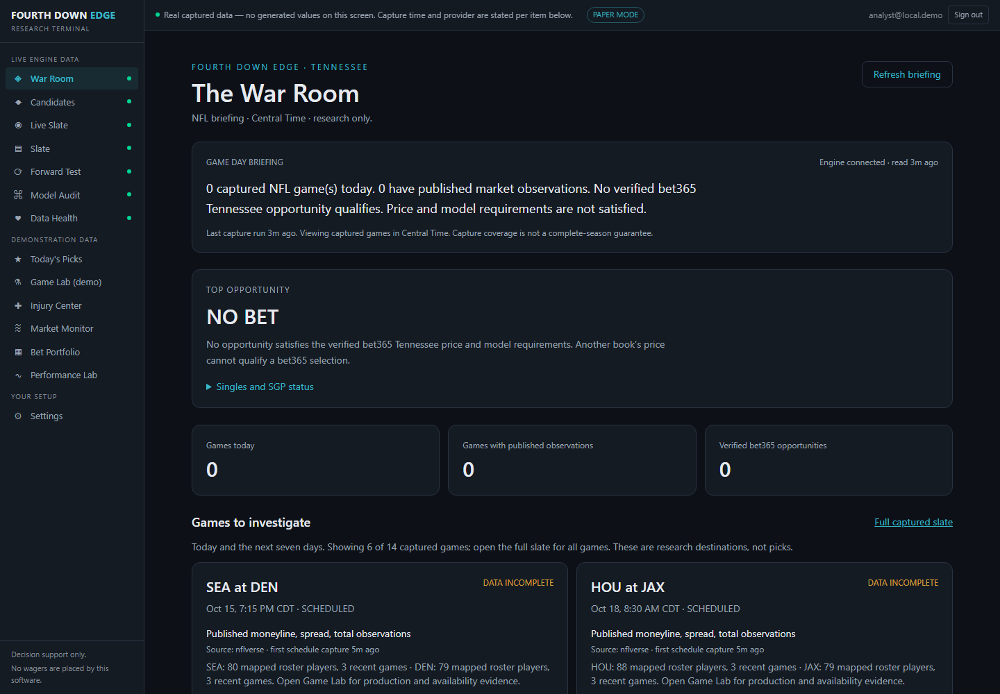
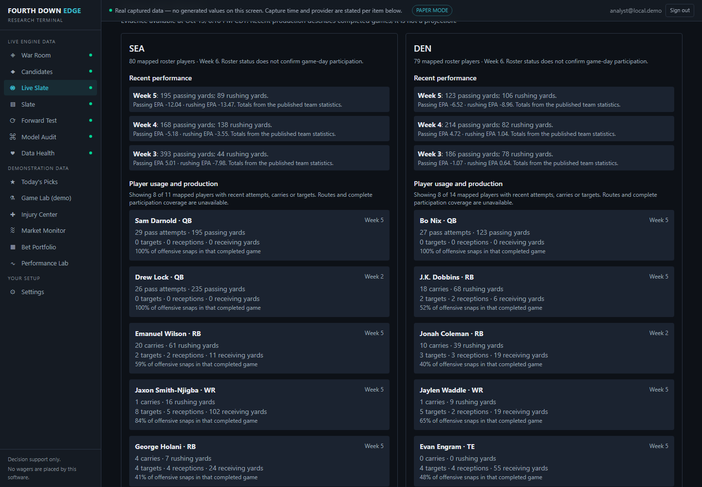
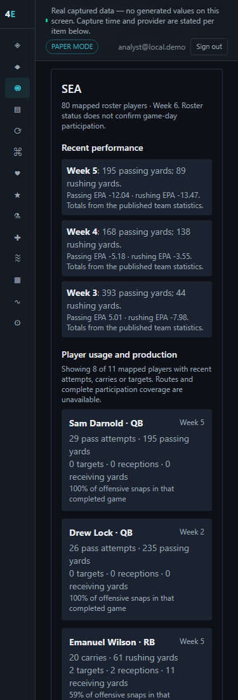

# Release 1B.2 actual research acceptance

Implementation source: `2656f1b64bf2da9285af3c3d0a2eda261020bf10`; this package adds only evidence, without changing application code. New QA directory; older frozen QA/screenshots remain unchanged.

[Source CI](https://github.com/Mike3931/fourth-down-edge/actions/runs/38494648740), [independent rerun](https://github.com/Mike3931/fourth-down-edge/actions/runs/38495104812), [required engine CI](https://github.com/Mike3931/fourth-down-edge/actions/runs/38494648702) passed on this implementation SHA. A fresh exact-head CI run is required after adding this evidence commit; the PR records its final SHA/results.

- 1,529 backend cases passed; all PostgreSQL gates passed, including 25 domain-identity cases with actual player contention and immutable-trigger refusal, 14 populated upgrades, downgrade/re-upgrade, 12 semantic races, 15 record chains and 11 recovery cases. Counts overlap; no summation as unique tests.
- 239 frontend cases, production build/typecheck, schema/RLS, bundle-secret/dependency gates and 28 default-parallel CI browser cases passed. Local standard browser acceptance passed 28 with one worker; local actual populated engine passed all seven, including desktop/mobile player evidence and source timing. Eight concurrent real briefing requests all returned 200/NO_BET in 1.046 seconds total; this is not a load/SLA claim.
- Eight existing international-slate tests skip without an ingested full-season schedule fixture in deterministic CI. The core's 51 deselections execute in dedicated PostgreSQL gates. The public-source case skipped in engine CI passed locally. Deployment intentionally skipped. Network exclusion and existing two moderate router/Python advisory exceptions remain; no zero-vulnerability claim.

## Actual coverage

| Public source | Source rows | Accepted research rows |
|---|---:|---:|
| Regular-season schedule | 272 | 272 canonical games; 79 governed finals |
| Player catalog | 24,853 | 24,853 GSIS identities; 16,586 ESPN and 22,688 PFR bindings |
| Rosters | 3,035 | 2,839; 196 withheld |
| Team statistics | 158 | 158 |
| Player statistics | 5,506 | 5,501; five withheld |
| Snap counts | 7,370 | 7,356; 14 withheld |
| Secondary injuries | 1,413 | 1,413 game/player/team links, not verified official availability |

Rosters contain available rows through week 6; team/player/snap/injury exports reach week 5. No complete current-week official injury/inactive list was accepted. Routes and comprehensive participation remain unavailable. Counts do not establish full historical weekly roster coverage.

The schedule joined 15 ESPN matches without creating duplicate identities. Actual re-download of all seven sources retained exactly seven source vintages, 17,267 research facts and 64,127 bindings. New polls/manifests are audit attempts, not duplicate historical facts. A cutoff one microsecond before the actual player-stat response had zero player production; a later cutoff prepared 11 SEA and 14 DEN players. See [coverage/PIT evidence](release1b2-v4-actual-coverage.json) and [actual repeat download](release1b2-v4-provider-repeat.json).

## Screenshots

Real source data from the owned isolated workspace; signed-in local session is not the source of NFL inputs. Production entries are descriptive completed-game observations, not starters, predictions or picks.

## Integrity and remaining dependencies

Regression acceptance covers name collisions, GSIS/ESPN/PFR mappings, source-ID conflicts, birth-date disagreements, unknown/ambiguous team and position information, trades, future/later source captures, correction history, delayed responses, repeat ingestion, failed polling/recovery, read-cache invalidation, OUT versus official INACTIVE and legacy roster preservation. Real acceptance uses only new attested scratch files; originals are not adopted or migrated.

Original database SHA-256: `133ff5b1a59229280ec19e84c59c314f200b377623b3bfa26de0fa583e2e5d0a`, unchanged. Three unresolved historical evaluations remain untouched. No master merge, deployment, installed update, subscription, paid provider or model promotion occurred.

Remaining gates: permission-compatible official availability/inactives and completeness; point-in-time role/route coverage and feature acceptance; authorized Tennessee bet365 singles/props/alternate/TD quote semantics; exact SGP combinability/combined pricing; qualified market-specific/joint models and prospective calibration. NO BET remains explicit. General bet365 advertising is not TN feed acceptance, and consensus AI/parlay multiplication cannot substitute for the sportsbook's combined quote.
